**[Personal website →](https://cixiangtao.github.io/cixiangtao/)** · [简体中文](README.zh-CN.md)

<picture>
  <source media="(max-width: 600px) and (prefers-color-scheme: dark)" srcset="https://raw.githubusercontent.com/cixiangtao/cixiangtao/main/output/profile-activity/dark-mobile.svg" />
  <source media="(max-width: 600px)" srcset="https://raw.githubusercontent.com/cixiangtao/cixiangtao/main/output/profile-activity/light-mobile.svg" />
  <source media="(prefers-color-scheme: dark)" srcset="https://raw.githubusercontent.com/cixiangtao/cixiangtao/main/output/profile-activity/dark.svg" />
  
</picture>

## Projects

Recently updated public projects. Refreshed daily.

<!-- recent-projects:start -->
| Project | What it does | Links |
| --- | --- | --- |
| [ikun-q](https://github.com/cixiangtao/ikun-q) | IKUN-Q：围绕同一只小鸟共同创作的角色社区与图鉴工具。代码开放协作，创作包逐步建设。 | [Website](https://ikun-q.cixiangtao.workers.dev) |
| [codex-coco](https://github.com/cixiangtao/codex-coco) | Codex Coco — a macOS desktop companion for Codex usage, appearance, and menu bar workflows. | — |
| [codex-project-chats](https://github.com/cixiangtao/codex-project-chats) | Browse Codex conversations by project and continue in the official Codex sidebar. | — |
| [ninebot-desktop](https://github.com/cixiangtao/ninebot-desktop) | 韭号出行：本地优先、只读的九号骑行轨迹、速度回放与数据导出桌面客户端（非官方） | — |
| [acer-almanac](https://github.com/cixiangtao/acer-almanac) | A deterministic Chinese almanac workspace with a TypeScript package, Web Component, Chrome extension, and live preview. | [Live demo](https://cixiangtao.github.io/acer-almanac/) · [npm](https://www.npmjs.com/package/acer-almanac) |
| [gerrit-cli](https://github.com/cixiangtao/gerrit-cli) | A safe local Git workflow CLI for Gerrit Code Review. | [npm](https://www.npmjs.com/package/@anys/gerrit-cli) |
| [nice-use-modal](https://github.com/cixiangtao/nice-use-modal) | A type-safe, headless React modal controller with explicit lifecycle APIs. | [Live demo](https://cixiangtao.github.io/nice-use-modal/) · [npm](https://www.npmjs.com/package/nice-use-modal) |
| [url-join](https://github.com/cixiangtao/url-join) | A TypeScript utility for joining URL segments with null-safe filtering and query parameters | [npm](https://www.npmjs.com/package/@anys/url-join) |
| [sprite-pet](https://github.com/cixiangtao/sprite-pet) | A framework-agnostic browser runtime for animated web pets. | [Live demo](https://cixiangtao.github.io/sprite-pet/) · [npm](https://www.npmjs.com/package/sprite-pet) |
| [vite-plugin-tailwind-merge](https://github.com/cixiangtao/vite-plugin-tailwind-merge) | Automatically merge conflicting Tailwind CSS classes in Vite builds. | [npm](https://www.npmjs.com/package/vite-plugin-tailwind-merge) |
| [sticker-ui](https://github.com/cixiangtao/sticker-ui) | A source-first handbook sticker style React + Tailwind component registry. | [Live preview](https://sticker-ui.cixiangtao.workers.dev/) |
| [vite-plugin-locator](https://github.com/cixiangtao/vite-plugin-locator) | One-call LocatorJS integration for Vite 5–8 and multiple UI frameworks | [npm](https://www.npmjs.com/package/vite-plugin-locator) |
<!-- recent-projects:end -->
