**[个人网站 →](https://cixiangtao.github.io/cixiangtao/zh/)** · [English](README.md)

<picture>
  <source media="(max-width: 600px) and (prefers-color-scheme: dark)" srcset="https://raw.githubusercontent.com/cixiangtao/cixiangtao/main/output/profile-activity/dark-mobile.svg" />
  <source media="(max-width: 600px)" srcset="https://raw.githubusercontent.com/cixiangtao/cixiangtao/main/output/profile-activity/light-mobile.svg" />
  <source media="(prefers-color-scheme: dark)" srcset="https://raw.githubusercontent.com/cixiangtao/cixiangtao/main/output/profile-activity/dark.svg" />
  
</picture>

## 项目

最近更新的公开项目，每日自动刷新。

<!-- recent-projects:start -->
| 项目 | 简介 | 链接 |
| --- | --- | --- |
| [ikun-q](https://github.com/cixiangtao/ikun-q) | IKUN-Q：围绕同一只小鸟共同创作的角色社区与图鉴工具。代码开放协作，创作包逐步建设。 | [网站](https://ikun-q.cixiangtao.workers.dev) |
| [codex-coco](https://github.com/cixiangtao/codex-coco) | Codex Coco — a macOS desktop companion for Codex usage, appearance, and menu bar workflows. | — |
| [codex-project-chats](https://github.com/cixiangtao/codex-project-chats) | Browse Codex conversations by project and continue in the official Codex sidebar. | — |
| [ninebot-desktop](https://github.com/cixiangtao/ninebot-desktop) | 韭号出行：本地优先、只读的九号骑行轨迹、速度回放与数据导出桌面客户端（非官方） | — |
| [acer-almanac](https://github.com/cixiangtao/acer-almanac) | 包含 TypeScript 包、Web Component、Chrome 扩展与在线演示的确定性老黄历工具集 | [演示](https://cixiangtao.github.io/acer-almanac/) · [npm](https://www.npmjs.com/package/acer-almanac) |
| [gerrit-cli](https://github.com/cixiangtao/gerrit-cli) | 面向 Gerrit 安装、诊断、同步与送审的安全本地 Git 工作流 CLI | [npm](https://www.npmjs.com/package/@anys/gerrit-cli) |
| [nice-use-modal](https://github.com/cixiangtao/nice-use-modal) | 类型安全、无样式且具有明确 show/hide/destroy 生命周期的 React 模态框控制器 | [演示](https://cixiangtao.github.io/nice-use-modal/) · [npm](https://www.npmjs.com/package/nice-use-modal) |
| [url-join](https://github.com/cixiangtao/url-join) | 支持空值过滤、协议安全与查询参数的零依赖 TypeScript URL 拼接工具 | [npm](https://www.npmjs.com/package/@anys/url-join) |
| [sprite-pet](https://github.com/cixiangtao/sprite-pet) | 用于确定性 Canvas 精灵宠物动画的框架无关 TypeScript 运行时 | [演示](https://cixiangtao.github.io/sprite-pet/) · [npm](https://www.npmjs.com/package/sprite-pet) |
| [vite-plugin-tailwind-merge](https://github.com/cixiangtao/vite-plugin-tailwind-merge) | 在 Vite 转换阶段处理 JSX 静态与动态类名中的 Tailwind CSS 冲突 | [npm](https://www.npmjs.com/package/vite-plugin-tailwind-merge) |
| [sticker-ui](https://github.com/cixiangtao/sticker-ui) | 手册贴纸风格的 React 与 Tailwind CSS 组件库和源码 Registry | [预览](https://sticker-ui.cixiangtao.workers.dev/) |
| [vite-plugin-locator](https://github.com/cixiangtao/vite-plugin-locator) | 为 Vite 5–8 项目提供一次调用即可完成的 LocatorJS 集成 | [npm](https://www.npmjs.com/package/vite-plugin-locator) |
<!-- recent-projects:end -->
